# TILCOR v2.0 — Rasmiy Ma'lumotlar Lug‘ati (DATA_DICTIONARY.md)

Dissertatsiya mavzusi: *"TARJIMA VA TENG MATNLAR PARALLEL KORPUSIDA O‘ZARO FAOL BIRIKUVCHI (KOLLOKATSION) SO‘ZLAR TADQIQI (o‘zbek va ingliz tillari misolida)"*  
Ixtisoslik: 10.02.20 – Qiyosiy tilshunoslik, chog‘ishtirma tilshunoslik va tarjimashunoslik  
Hujjat versiyasi: 2.0 (3-bosqich: Ma'lumotlar poydevori)

---

## 1. Entity-Relationship (ER) Diagrammasi (12 ta Asosiy Ob'ekt)

```mermaid
erDiagram
    WORKS ||--o{ EDITIONS : "nashrlari mavjud"
    WORKS ||--o{ TEXTS : "matn shakllari"
    EDITIONS ||--o{ TEXTS : "nashrga tegishli"
    TEXTS ||--o{ PAGES : "sahifalardan iborat"
    TEXTS ||--o{ SEGMENTS : "segmentlarni o'z ichiga oladi"
    PAGES ||--o{ SEGMENTS : "sahifadagi jumlalar"
    TEXTS ||--o{ ALIGNMENTS : "manba yoki tarjima matni"
    SEGMENTS ||--o{ COLLOCATION_OCCURRENCES : "kollokatsiya uchrashi"
    LEXICON_ENTRIES ||--o{ COLLOCATION_OCCURRENCES : "lug'aviy asos"
    ALIGNMENTS ||--o{ COLLOCATION_OCCURRENCES : "parallel kontekst"
    COLLOCATION_OCCURRENCES ||--o{ EQUIVALENTS : "tarjima ekvivalenti"
    SEGMENTS ||--o{ EQUIVALENTS : "maqsadli segment spani"
    COLLOCATION_OCCURRENCES ||--o{ ANNOTATIONS : "inson annotatsiyasi"
    TAXONOMIES ||--o{ ANNOTATIONS : "tasnifiy standart"
    WORKS {
        string id PK
        string title
        string author
        string original_language
        int year
    }
    EDITIONS {
        string id PK
        string work_id FK
        string publisher
        string place
        int year
        string isbn
        int print_pages
        int pdf_pages
        string source_filename
        string source_file_sha256
    }
    TEXTS {
        string id PK
        string work_id FK
        string edition_id FK
        string role
        string language
        string translator
        string direction
        string status
    }
    PAGES {
        string id PK
        string text_id FK
        int pdf_page_num
        int printed_page_num
        string raw_text
        string normalized_text
        int char_count
        int token_count
        int has_text_layer
        string extraction_method
        string quality_flags
    }
    SEGMENTS {
        string id PK
        string text_id FK
        string page_id FK
        int pdf_page_num
        int segment_order
        string raw_text
        string normalized_text
        int token_count
        int char_start
        int char_end
        string paragraph_id
        string extraction_method
        string quality_flags
    }
    ALIGNMENTS {
        string id PK
        string pair_id
        string source_text_id FK
        string target_text_id FK
        string source_segment_ids
        string target_segment_ids
        string source_text
        string target_text
        string alignment_type
        string method
        float raw_score
        string score_meaning
        string status
        string reviewer
        string note
    }
    LEXICON_ENTRIES {
        string id PK
        string surface_form_en
        string surface_form_uz
        string lemma_en
        string lemma_uz
        string pattern
        string provenance
        string source_file
        string status
        string exclusion_reason
    }
    COLLOCATION_OCCURRENCES {
        string id PK
        string lexicon_entry_id FK
        string segment_id FK
        string alignment_id FK
        string surface_form
        string lemma_form
        int token_start_offset
        int token_end_offset
        int is_verified
    }
    EQUIVALENTS {
        string id PK
        string occurrence_id FK
        string target_segment_id FK
        string target_span
        string equivalence_type
        string translation_strategy
        int is_verified
    }
    ANNOTATIONS {
        string id PK
        string entity_type
        string entity_id
        string field
        string value
        string guideline_version
        string annotator
        string status
        string history
    }
    TAXONOMIES {
        string id PK
        string taxonomy_name
        string code
        string label_uz
        string label_en
        string definition
        string examples
        string version
    }
    AUDIT_LOG {
        int id PK
        string user
        string action
        string entity
        string entity_id
        string changes
        datetime timestamp
    }
```

---

## 2. To‘liq Maydonlar Tavsifi (Data Dictionary Specification)

### 2.1. `works` (Asarlar Ro‘yxati)
| Maydon nomi | Turi | Cheklovlar | Tavsif va Misol |
|-------------|------|------------|-----------------|
| `id` | TEXT | PRIMARY KEY | Asarning stabil kodi: `work-cholpon-kk`, `work-hemingway-oms`, `work-stevenson-ti`. |
| `title` | TEXT | NOT NULL | Asarning asl nomi: *Kecha va kunduz*, *The Old Man and the Sea*, *Treasure Island*. |
| `author` | TEXT | NOT NULL | Asar muallifi: *Abdulhamid Cho‘lpon*, *Ernest Hemingway*, *Robert Louis Stevenson*. |
| `original_language` | TEXT | NOT NULL | Asl yozilgan til: `uz` yoki `en`. |
| `year` | INTEGER | NULL | Birinchi yozilgan / chop etilgan yil: `1936`, `1952`, `1883`. |
| `created_at` | TIMESTAMP | DEFAULT NOW | Yaratilgan vaqti. |

### 2.2. `editions` (Nashrlar va Bibliografik Pasport)
| Maydon nomi | Turi | Cheklovlar | Tavsif va Misol |
|-------------|------|------------|-----------------|
| `id` | TEXT | PRIMARY KEY | Nashr kodi: `ed-cholpon-uz`, `ed-cholpon-en`, `ed-hemingway-en`, `ed-hemingway-uz`. |
| `work_id` | TEXT | FK `works(id)` | Bog‘langan asar kodi. |
| `publisher` | TEXT | NULL | Nashriyot: *Academic Studies Press*, *Charles Scribner's Sons*, *G‘afur G‘ulom*. |
| `place` | TEXT | NULL | Nashr shahri: *Boston*, *New York*, *Toshkent*, *London*. |
| `year` | INTEGER | NULL | Nashr yili: `2020`, `1952`, `1986`, `1974`. |
| `isbn` | TEXT | NULL | ISBN kodi (agar mavjud bo‘lsa): `978-1-64469-048-2`. |
| `print_pages` | INTEGER | NULL | Bosma kitobning sahifalar soni. |
| `pdf_pages` | INTEGER | NOT NULL | PDF hujjatning haqiqiy sahifalar soni. |
| `source_filename` | TEXT | NOT NULL | Asl manba fayli nomi: `cholpon-kecha-va-kunduz.pdf`. |
| `source_file_sha256` | TEXT | NOT NULL | Asl faylning 64-belgili SHA256 nazorat summasi. |
| `created_at` | TIMESTAMP | DEFAULT NOW | Yaratilgan vaqti. |

### 2.3. `texts` (Matn Qatlamlari va Yo‘nalish)
| Maydon nomi | Turi | Cheklovlar | Tavsif va Misol |
|-------------|------|------------|-----------------|
| `id` | TEXT | PRIMARY KEY | Matn kodi: `txt-cholpon-uz`, `txt-cholpon-en`, `txt-hemingway-en`. |
| `work_id` | TEXT | FK `works(id)` | Asar kodi. |
| `edition_id` | TEXT | FK `editions(id)` | Nashr kodi. |
| `role` | TEXT | NOT NULL | Roli: `original` (asl nusxa) yoki `translation` (tarjima). |
| `language` | TEXT | NOT NULL | Tili: `uz` yoki `en`. |
| `translator` | TEXT | NULL | Tarjimon: *Christopher Fort*, *Ibrohim G‘afurov*, *Sharif Rizo*. |
| `direction` | TEXT | NOT NULL | Korpus yo‘nalishi: `UZ->EN` yoki `EN->UZ`. |
| `status` | TEXT | DEFAULT 'active' | Maqomi: `active` yoki `quarantined` (Stivenson o‘zbekcha matni uchun). |
| `created_at` | TIMESTAMP | DEFAULT NOW | Yaratilgan vaqti. |

### 2.4. `pages` (Sahifalar Qatlami)
| Maydon nomi | Turi | Cheklovlar | Tavsif va Misol |
|-------------|------|------------|-----------------|
| `id` | TEXT | PRIMARY KEY | Sahifa kodi: `p-cholpon-uz-004`. |
| `text_id` | TEXT | FK `texts(id)` | Matn kodi. |
| `pdf_page_num` | INTEGER | NOT NULL | PDF dagi 1-asosli sahifa raqami (`1` dan `N` gacha). |
| `printed_page_num` | INTEGER | NULL | Faqat inson tasdiqlagan bosma sahifa raqami (aks holda NULL). |
| `raw_text` | TEXT | NOT NULL | PDF dan olingan xom, o‘zgartirilmagan matn. |
| `normalized_text` | TEXT | NOT NULL | Qidiruv uchun normallashgan matn (U+02BB va U+02BC bilan). |
| `char_count` | INTEGER | NOT NULL | Belgilar soni. |
| `token_count` | INTEGER | NOT NULL | So‘zlar soni. |
| `has_text_layer` | INTEGER | NOT NULL | `1` — raqamli matn qatlami mavjud, `0` — skanerlangan rasm. |
| `extraction_method` | TEXT | NOT NULL | Matn ajratish vositasi: `pymupdf`, `pypdf`, `tesseract_ocr`. |
| `quality_flags` | TEXT | DEFAULT 'OK' | Sifat bayroqlari: `OK`, `NO_TEXT_LAYER`, `SUSPICIOUS_HYPHEN`. |

### 2.5. `segments` (Matn Segmentlari / Jumlalar)
| Maydon nomi | Turi | Cheklovlar | Tavsif va Misol |
|-------------|------|------------|-----------------|
| `id` | TEXT | PRIMARY KEY | Stabil identifikator: masalan, `CK-UZ-p004-s001`, `ND-EN-p049-s001`. |
| `text_id` | TEXT | FK `texts(id)` | Matn kodi. |
| `page_id` | TEXT | FK `pages(id)` | Sahifa kodi. |
| `pdf_page_num` | INTEGER | NOT NULL | Sahifa raqami. |
| `segment_order` | INTEGER | NOT NULL | Sahifa ichidagi jumla tartib raqami. |
| `raw_text` | TEXT | NOT NULL | Jumlaning o‘zgarmagan asl nusxasi. |
| `normalized_text` | TEXT | NOT NULL | Qidiruv uchun normallashgan va kichik harflarga o‘tkazilgan jumla. |
| `token_count` | INTEGER | NOT NULL | Jumladagi tokenlar soni. |
| `char_start` | INTEGER | NULL | Sahifa matnidagi boshlanish belgisi indeksi. |
| `char_end` | INTEGER | NULL | Sahifa matnidagi tugash belgisi indeksi. |
| `paragraph_id` | TEXT | NULL | Paragraf identifikatori. |
| `extraction_method` | TEXT | NOT NULL | Segmentator algoritmi (`sentence_splitter_v2`). |
| `quality_flags` | TEXT | DEFAULT 'OK' | Sifat holati. |

### 2.6. `alignments` (Parallel Jumlalar Tekislashi)
| Maydon nomi | Turi | Cheklovlar | Tavsif va Misol |
|-------------|------|------------|-----------------|
| `id` | TEXT | PRIMARY KEY | Tekislash kodi: `aln-cholpon-0001`. |
| `pair_id` | TEXT | NOT NULL | Juftlik: `pair-cholpon`, `pair-hemingway`. |
| `source_text_id` | TEXT | FK `texts(id)` | Manba matn kodi. |
| `target_text_id` | TEXT | FK `texts(id)` | Tarjima matn kodi. |
| `source_segment_ids`| TEXT | NOT NULL | JSON massiv: `["CK-UZ-p004-s001"]`. |
| `target_segment_ids`| TEXT | NOT NULL | JSON massiv: `["ND-EN-p049-s001"]`. |
| `source_text` | TEXT | NOT NULL | Birlashtirilgan manba matni. |
| `target_text` | TEXT | NOT NULL | Birlashtirilgan tarjima matni. |
| `alignment_type` | TEXT | NOT NULL | `1:1`, `1:2`, `2:1`, `1:0`, `0:1`, `n:m`. |
| `method` | TEXT | NOT NULL | `gale_church`, `hunalign_lexicon`, `manual_gold`. |
| `raw_score` | REAL | NULL | Algoritm hisoblagan xom masofa / ball. |
| `score_meaning` | TEXT | NULL | Ballning aniq ma'nosi: masalan, `Gale-Church delta length correlation score`. |
| `status` | TEXT | NOT NULL | `auto`, `needs_review`, `confirmed`, `rejected`, `excluded`. |
| `reviewer` | TEXT | NULL | Tekshiruvchi ismi. |
| `note` | TEXT | NULL | Tadqiqotchi izohi. |

### 2.7. `lexicon_entries` (Malumotnoma Kollokatsiyalar Ro‘yxati)
| Maydon nomi | Turi | Cheklovlar | Tavsif va Misol |
|-------------|------|------------|-----------------|
| `id` | TEXT | PRIMARY KEY | Birikma kodi: `colloc-1`, `colloc-6411`. |
| `surface_form_en` | TEXT | NOT NULL | Inglizcha yuzaki shakli: *cold gaze*, *make a decision*. |
| `surface_form_uz` | TEXT | NOT NULL | O‘zbekcha yuzaki shakli: *sovuq nigoh*, *qaror qabul qilmoq*. |
| `lemma_en` | TEXT | NULL | Inglizcha bosh so‘z. |
| `lemma_uz` | TEXT | NULL | O‘zbekcha bosh so‘z. |
| `pattern` | TEXT | NULL | Struktur qolip: `Sifat + Ot`, `Feʼl + Ot`. |
| `provenance` | TEXT | NOT NULL | Halol kelib chiqish manbasi: `user-supplied reference list: collocations_full.json`. |
| `source_file` | TEXT | NOT NULL | Boshlang‘ich fayl nomi. |
| `status` | TEXT | DEFAULT 'active' | `active` yoki `excluded`. |
| `exclusion_reason` | TEXT | NULL | Karantin sababi: `D6: Sintetik yoki takroriy demo yozuv`. |

### 2.8. `collocation_occurrences` (Korpusdagi Uchrashlar)
| Maydon nomi | Turi | Cheklovlar | Tavsif va Misol |
|-------------|------|------------|-----------------|
| `id` | TEXT | PRIMARY KEY | Uchrash kodi: `occ-kk-001-01`. |
| `lexicon_entry_id` | TEXT | FK `lexicon_entries`| Lug‘aviy maqola kodi. |
| `segment_id` | TEXT | FK `segments(id)` | Qaysi segmentda uchragani. |
| `alignment_id` | TEXT | FK `alignments(id)`| Qaysi parallel juftlikda uchragani. |
| `surface_form` | TEXT | NOT NULL | Matndagi aniq shakli. |
| `lemma_form` | TEXT | NOT NULL | Bosh shakli. |
| `token_start_offset`| INTEGER | NULL | Token offset boshlanishi. |
| `token_end_offset` | INTEGER | NULL | Token offset tugashi. |
| `is_verified` | INTEGER | DEFAULT 0 | `1` — tadqiqotchi tasdiqlagan, `0` — avtomatik nomzod. |

### 2.9. `equivalents` (Tarjima Ekvivalentlari)
| Maydon nomi | Turi | Cheklovlar | Tavsif va Misol |
|-------------|------|------------|-----------------|
| `id` | TEXT | PRIMARY KEY | Ekvivalent kodi: `eq-0001`. |
| `occurrence_id` | TEXT | FK `collocation_occurrences` | Birlamchi kollokatsiya kodi. |
| `target_segment_id`| TEXT | FK `segments(id)` | Tarjima segmenti. |
| `target_span` | TEXT | NOT NULL | Tarjimada mos kelgan so‘z birikmasi. |
| `equivalence_type` | TEXT | NOT NULL | `full_equivalent`, `partial_equivalent`, `conceptual_substitute`, `calque_trap`. |
| `translation_strategy`| TEXT | NOT NULL | `direct_lexical`, `functional_shift`, `descriptive_expansion`, `omission`. |
| `is_verified` | INTEGER | DEFAULT 0 | Inson tasdiqlaganlik bayrog‘i. |

### 2.10. `annotations` (Tadqiqotchi Annotatsiyalari)
| Maydon nomi | Turi | Cheklovlar | Tavsif va Misol |
|-------------|------|------------|-----------------|
| `id` | TEXT | PRIMARY KEY | Annotatsiya kodi: `ann-0001`. |
| `entity_type` | TEXT | NOT NULL | `occurrence`, `equivalent`, `alignment`. |
| `entity_id` | TEXT | NOT NULL | Ob'ekt kodi. |
| `field` | TEXT | NOT NULL | Tahlil sohasi: `grammatical_pattern`, `equivalence_type`, `cultural_note`. |
| `value` | TEXT | NOT NULL | Qo‘yilgan ilmiy baho / qiymat. |
| `guideline_version`| TEXT | DEFAULT 'v2.0_2026'| Qaysi qo‘llanma standarti asosida. |
| `annotator` | TEXT | NOT NULL | Tadqiqotchi ismi-sharifi. |
| `status` | TEXT | DEFAULT 'draft' | `draft`, `reviewed`, `confirmed`. |
| `history` | TEXT | NULL | JSON formatida o‘zgarishlar tarixi. |

### 2.11. `taxonomies` (Standart Klassifikatorlar)
| Maydon nomi | Turi | Cheklovlar | Tavsif va Misol |
|-------------|------|------------|-----------------|
| `id` | TEXT | PRIMARY KEY | Taksonomiya kodi: `tax-pat-adj-noun`, `tax-eq-full`. |
| `taxonomy_name` | TEXT | NOT NULL | Bo‘lim: `pattern` (3.1), `equivalence` (3.2), `culture` (3.3). |
| `code` | TEXT | NOT NULL | Qisqa kodi: `Adj+Noun`, `Full`, `CalqueTrap`. |
| `label_uz` | TEXT | NOT NULL | O‘zbekcha rasmiy nomi: *Sifat + Ot*, *To‘liq ekvivalent*. |
| `label_en` | TEXT | NOT NULL | Inglizcha xalqaro nomi: *Adjective + Noun*, *Full Equivalent*. |
| `definition` | TEXT | NOT NULL | Ilmiy ta'rifi. |
| `examples` | TEXT | NOT NULL | Asarlardan tasdiqlangan misollar. |
| `version` | TEXT | DEFAULT '1.0' | Versiyasi. |

### 2.12. `audit_log` (Tizim Audit Tarixi)
| Maydon nomi | Turi | Cheklovlar | Tavsif va Misol |
|-------------|------|------------|-----------------|
| `id` | INTEGER | PK AUTOINCREMENT | Log yozuvi tartib raqami. |
| `user` | TEXT | NOT NULL | Harakatni bajargan shaxs / tizim roli. |
| `action` | TEXT | NOT NULL | `INSERT`, `UPDATE`, `DELETE`, `MIGRATE`, `ROLLBACK`. |
| `entity` | TEXT | NOT NULL | O‘zgargan jadval nomi. |
| `entity_id` | TEXT | NOT NULL | O‘zgargan qator identifikatori. |
| `changes` | TEXT | NOT NULL | JSON diff ko‘rinishidagi o‘zgarishlar tafsiloti. |
| `timestamp` | TIMESTAMP | DEFAULT NOW | O‘zgarish yuz bergan aniq vaqt. |

---

## 3. Unicode Normalizatsiya Standarti (Prompt 3 Talabi)

### 3.1. Asosiy Qoida:
1. **Asl matn tegilmaydi:** `raw_text` maydonida PDF fayldan qanday belgi kelgan bo‘lsa, aynan shu holida saqlanadi.
2. **Qidiruv maydonida kanonik xaritalash:** `normalized_text` maydonida qidiruv va tahlilning barqarorligi uchun barcha variantlar quyidagi kanonik belgilarga keltiriladi:
   - **`oʻ` va `gʻ` harflari:** `o` yoki `g` dan keyin kelgan barcha variantlar (`‘`, `'`, `’`, `` ` ``, `´`) yagona **`U+02BB`** (MODIFIER LETTER TURNED COMMA) belgisiga keltiriladi.
   - **Tutuq belgisi (glottal stop):** So‘z ichidagi barcha boshqa apostrof variantlari yagona **`U+02BC`** (MODIFIER LETTER APOSTROPHE) belgisiga keltiriladi.
   - **Kirill yozuvi:** Matnda kirillcha harflar uchrasa (masalan, *ҳаёт*), ular **aslo o‘zboshimchalik bilan transliteratsiya qilinmaydi**, o‘z holicha saqlanadi.

### 3.2. Xaritalash Jadvali:
| Asl manbadagi belgi | Unicode kodi | So‘z ichidagi o‘rni | Kanonik natija | Kanonik Unicode | Misol |
|---------------------|--------------|-------------------|----------------|-----------------|-------|
| `‘` | U+2018 | `o` yoki `g` dan keyin | `ʻ` | **U+02BB** | `o‘tmoq` $\rightarrow$ `oʻtmoq` |
| `'` | U+0027 | `o` yoki `g` dan keyin | `ʻ` | **U+02BB** | `g'olib` $\rightarrow$ `gʻolib` |
| `’` | U+2019 | `o` yoki `g` dan keyin | `ʻ` | **U+02BB** | `O’zbekiston` $\rightarrow$ `oʻzbekiston` |
| `` ` `` | U+0060 | `o` yoki `g` dan keyin | `ʻ` | **U+02BB** | `o\`g\`il` $\rightarrow$ `oʻgʻil` |
| `'` | U+0027 | Boshqa harflardan keyin | `ʼ` | **U+02BC** | `ma'no` $\rightarrow$ `maʼno` |
| `’` | U+2019 | Boshqa harflardan keyin | `ʼ` | **U+02BC** | `san’at` $\rightarrow$ `sanʼat` |
| `` ` `` | U+0060 | Boshqa harflardan keyin | `ʼ` | **U+02BC** | `ta\`lim` $\rightarrow$ `taʼlim` |
| Кирил алифбоси | U+0400 – U+04FF | Har qanday | Asl holicha | Asl kodi | `ҳаёт` $\rightarrow$ `ҳаёт` |
