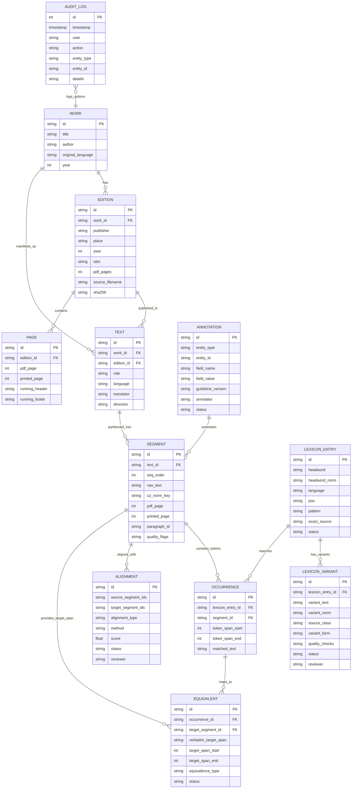

# TILCOR — Maʼlumotlar Modeli va Lug‘ati (Data Dictionary & ER Diagram)
**Hujjat versiyasi:** 2.0 (Step 03, TILCOR_03-1 Part 5)  
**Tizim:** TILCOR Parallel Korpus & Leksikografik Tahlil Platformasi  
**Holat:** Ishchi va orqaga qaytuvchi (Reversible migration, `corpus.db`)

---

## 1. Konseptual ER Diagramma

---

## 2. Jadvallar Taʼrifi (Entity Dictionary)

### 2.1 `work` (Asar)
Adabiy yoki ilmiy manbaning umumiy intellektual obyekti.
- `id` (TEXT, PK): Barqaror identifikator (`kvk`, `oms`).
- `title` (TEXT): Asarning rasmiy nomi (*Kecha va kunduz*, *The Old Man and the Sea*).
- `author` (TEXT): Muallifning toʻliq ismi (*Abdulhamid Cho‘lpon*, *Ernest Hemingway*).
- `original_language` (TEXT): Asar yaratilgan til kodi (`uz`, `en`).
- `year` (INTEGER): Asar yaratilgan / ilk nashr yili (1936, 1952).

### 2.2 `edition` (Nashr)
Muayyan manba fayl va uning bibliografik parametrlari.
- `id` (TEXT, PK): Nashr identifikatori (`ed-kvk-uz`, `ed-kvk-en`, `ed-oms-en`, `ed-oms-uz`).
- `work_id` (TEXT, FK -> `work.id`).
- `publisher` (TEXT): Nashriyot nomi («Sharq» NMK, Academic Studies Press, «Yosh gvardiya»).
- `place` (TEXT): Nashr etilgan shahar (Toshkent, Boston).
- `year` (INTEGER): Nashr yili (2000, 2019, 1986).
- `pdf_pages` (INTEGER): PDF dagi umumiy sahifalar soni (272, 235, 52, 46).
- `source_filename` (TEXT): `sources/` papkasidagi fayl nomi.
- `sha256` (TEXT): Fayl yaxlitligi nazorat xeshi (SHA-256).

### 2.3 `text` (Matn darajasi)
Asarning muayyan tildagi roli (asliyat yoki tarjima).
- `id` (TEXT, PK): `txt-kvk-uz`, `txt-kvk-en`, `txt-oms-en`, `txt-oms-uz`.
- `work_id` (TEXT, FK).
- `edition_id` (TEXT, FK).
- `role` (TEXT): `original` yoki `translation`.
- `language` (TEXT): `uz` yoki `en`.
- `translator` (TEXT): Tarjimon ismi (Christopher Fort, Ibrohim G‘ofurov).
- `direction` (TEXT): Qiyoslash yoʻnalishi (`uz-en`, `en-uz`).

### 2.4 `page` (Sahifa)
PDF va bosma kitob sahifalarining aniq karrasligi.
- `id` (TEXT, PK): Masalan `kvk-uz-p015`.
- `edition_id` (TEXT, FK).
- `pdf_page` (INTEGER): PDF sahifa raqami (1-indexed).
- `printed_page` (INTEGER): Kitobda bosilgan sahifa raqami (Ziyouz / Fort bosma raqamlari).
- `running_header` (TEXT): Sahifa tepasidagi kolontitul.
- `running_footer` (TEXT): Sahifa tagidagi kolontitul.

### 2.5 `segment` (Segment / Gap)
Tekislash va qidiruvning elementar birligi.
- `id` (TEXT, PK): Barqaror identifikator (masalan, `OMS-EN-p012-s004`).
- `text_id` (TEXT, FK -> `text.id`).
- `seq_order` (INTEGER): Matndagi tartib raqami.
- `raw_text` (TEXT): Kitobdagi autentik belgi-belgiga matn (oʻzgartirilmaydi).
- `uz_norm_key` (TEXT): `uz_norm()` orqali olingan yashirin qidiruv kaliti.
- `pdf_page` (INTEGER): PDF sahifasi.
- `printed_page` (INTEGER): Dissertatsiyada havola qilinadigan bosma sahifa.
- `paragraph_id` (TEXT): Xatboshi ID si.
- `quality_flags` (TEXT): Sifat belgilari (masalan, `clean`, `dialogue_dash`).

### 2.6 `alignment` (Tekislash)
Asliyat va tarjima segmentlari orasidagi oʻzaro bogʻlanish.
- `id` (TEXT, PK): Masalan `align-kvk-0042`.
- `source_segment_ids` (TEXT): Asliyat segmentlari ID lari (`["KVK-UZ-p005-s001"]`).
- `target_segment_ids` (TEXT): Tarjima segmentlari ID lari (`["KVK-EN-p045-s001"]`).
- `alignment_type` (TEXT): `1:1`, `1:2`, `2:1`, `1:0`, `0:1`, `2:2`.
- `method` (TEXT): Tekislash usuli (`manual_gold_535`, `sentence_transformers_v1`).
- `score` (REAL): Oʻxshashlik ehtimoli (0.0 – 1.0).
- `status` (TEXT): `unverified`, `confirmed_by_researcher`, `rejected`.
- `reviewer` (TEXT): Tekshirgan tadqiqotchi ismi.

### 2.7 `lexicon_entry` (Leksikografik birlik)
Lugʻat va akademik maʼlumotnomalardagi kollokatsiya yoki soʻz boshligi.
- `id` (TEXT, PK).
- `headword` (TEXT): Asosiy soʻz yoki birikma.
- `headword_norm` (TEXT): Normallashtirilgan shakl.
- `language` (TEXT): `en` yoki `uz`.
- `pos` (TEXT): Soʻz turkumi.
- `pattern` (TEXT): Kollokatsiya strukturasi (`Verb + Noun`).
- `exact_source` (TEXT): Aniq manba kitob va sahifasi.

### 2.8 `lexicon_variant` (O‘zbekcha muqobil)
Har bir inglizcha kollokatsiyaga berilgan 1–3 ta oʻzbekcha muqobil variant.
- `id` (TEXT, PK).
- `lexicon_entry_id` (TEXT, FK).
- `variant_text` (TEXT): Variant matni (*qaror qabul qilmoq*, *to‘yimli nonushta*).
- `variant_norm` (TEXT): `uz_norm()` boʻyicha rasmiy orfografiya.
- `source_class` (TEXT): `KORPUS`, `LUG‘AT`, `AI-taklif`, `tasdiqlangan`.
- `variant_form` (TEXT): `kollokatsiya`, `bitta so‘z`, `tasviriy ifoda`.
- `quality_checks` (TEXT): JSON avtomatik tekshiruv natijalari.
- `status` (TEXT): `AI-taklif (tekshirilmagan)` yoki `tasdiqlangan muqobil (tadqiqotchi)`.

### 2.9 `occurrence` (Korpusdagi qo‘llanish)
Kollokatsiyaning korpus segmentidagi aniq uchrashi.
- `id` (TEXT, PK).
- `lexicon_entry_id` (TEXT, FK).
- `segment_id` (TEXT, FK).
- `token_span_start` / `token_span_end` (INTEGER): Belgilar kesimi (offset).
- `matched_text` (TEXT): Asl matndagi qoʻllangan shakli.

### 2.10 `equivalent` (Ekvivalent — EQUIVALENT PRINCIPLE)
Korpusdagi qoʻllanishning tarjima matnidagi verifikatsiyalangan qismi.
- `id` (TEXT, PK).
- `occurrence_id` (TEXT, FK).
- `target_segment_id` (TEXT, FK).
- `verbatim_target_span` (TEXT): Tarjima jumlasi ichidagi aynan soʻzma-soʻz parcha.
- `equivalence_type` (TEXT): `to‘liq`, `qisman`, `funksional`, `tasviriy`.
- `status` (TEXT): `unverified`, `confirmed`.

### 2.11 `annotation` (Lingvistik annotatsiya)
Tadqiqotchi yoki ilmiy rahbar tomonidan qoʻyilgan semantik/uslubiy belgilar.

### 2.12 `audit_log` (Tahrirlar tarixi)
Barcha maʼmuriy tahrir, tasdiqlash va rad etish harakatlarining toʻliq jurnali.
