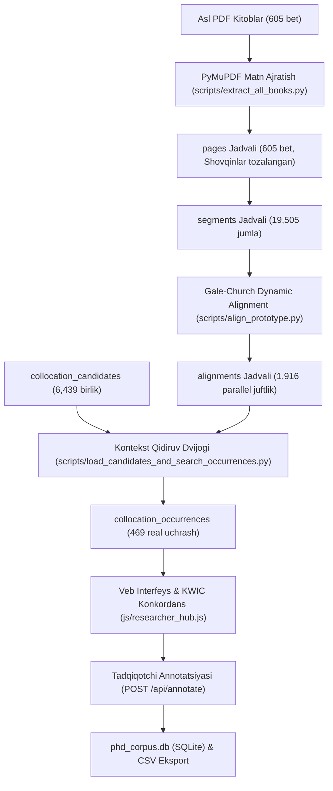

# O‘ZBEK–INGLIZ PARALLEL KORPUSI VA KOLLOKATSIYALAR TADQIQI PLATFORMASI
## PhD Ilmiy Tadqiqoti Uchun Rasmiy Topshirish Hujjati va Foydalanuvchi Qo‘llanmasi (Handover Documentation)

**Dissertatsiya mavzusi:**  
> **«TARJIMA VA TENG MATNLAR PARALLEL KORPUSIDA O‘ZARO FAOL BIRIKUVCHI (KOLLOKATSION) SO‘ZLAR TADQIQI (o‘zbek va ingliz tillari misolida)»**

---

### MUNDARIJA
1. [Sodda tildagi foydalanuvchi qo‘llanmasi (User Guide)](#1-sodda-tildagi-foydalanuvchi-qollanmasi)
2. [O‘rnatish va ishga tushirish yo‘riqnomasi (Windows 11 / Python 3.12)](#2-ornatish-va-ishga-tushirish-yoriqnomasi)
3. [Tizim arxitekturasi va ma’lumotlar oqimi (Architecture & Data Flow)](#3-tizim-arxitekturasi-va-malumotlar-oqimi)
4. [Ma’lumotlar lug‘ati va SQL relyatsion sxemasi (Data Dictionary & Schema)](#4-malumotlar-lugati-va-sql-relyatsion-sxemasi)
5. [PDF matnini ajratish va jumlalarni tekislash metodologiyasi (Extraction & Alignment)](#5-pdf-matnini-ajratish-va-jumlalarni-tekislash-metodologiyasi)
6. [Tadqiqotchi ilmiy annotatsiya yo‘riqnomasi (Annotation Guidelines Template)](#6-tadqiqotchi-ilmiy-annotatsiya-yoriqnomasi)
7. [Miqdoriy ko‘rsatkichlar formulalari va sozlamalari (Quantitative Formulas)](#7-miqdoriy-korsatkichlar-formulalari-va-sozlamalari)
8. [Sinov va ilmiy sifat kafolati hisoboti (QA & Validation Report)](#8-sinov-va-ilmiy-sifat-kafolati-hisoboti)
9. [Zaxira nusxa olish va nosozliklarni bartaraf etish (Backup & Restore)](#9-zaxira-nusxa-olish-va-nosozliklarni-bartaraf-etish)
10. [Mavjud ilmiy cheklovlar va istiqbolli rejalar (Limitations & Future Work)](#10-mavjud-ilmiy-cheklovlar-va-istiqbolli-rejalar)
11. [Bosqichma-bosqich tekshiruv va to‘liq reproduktsiya misoli (End-to-End Trace)](#11-bosqichma-bosqich-tekshiruv-va-toliq-reproduktsiya-misoli)

---

### 1. Sodda tildagi foydalanuvchi qo‘llanmasi
Platforma o‘zbek va ingliz tillaridagi badiiy va ilmiy matnlarni qiyosiy o‘rganish, kollokatsiyalarni aniqlash hamda ularni dissertatsiyaning II va III boblari talablariga mos ravishda tahlil qilish uchun mo‘ljallangan.

* **1-qadam (Korpusdan qidiruv):** Veb-interfeysdagi **«Parallel Korpus»** bo‘limiga kiring. 19,505 ta jumlalar ichidan istalgan so‘zni yozing (masalan, *«ko‘ngil»*, *«ajin»*, *«wrinkles»*, *«defeat»*).
* **2-qadam (Real qo‘llanilishlar - Occurrences):** **«Kollokatsiyalar Matritsasi»** bo‘limidagi **«Real Korpus Qo‘llanilishlari»** yorlig‘iga o‘ting. U yerda 469 ta birikmaning aynan qaysi kitobning nechanchi sahifasida, qaysi jumlada uchrashi ko‘rsatilgan.
* **3-qadam (KWIC Konkordans):** **«KWIC Konkordans Dasturi»** yorlig‘ida kalit so‘zni yozib, chap va o‘ng kontekst bilan parallel o‘rganing.
* **4-qadam (Annotatsiya va tasnif):** Har bir kollokatsiya kartochkasidagi **«✏️ Annotatsiya»** tugmasini bosing. Ochilgan modal oynada 7 ta ilmiy mezon (Model, Semantika, Ekvivalentlik, Strategiya, Madaniy belgi, Holat, Qayd) bo‘yicha tahlilingizni kiriting va saqlang.
* **5-qadam (Eksport):** **«📥 Eksport (CSV/Excel)»** tugmasini bosib, barcha tahlil natijalarini dissertatsiya ilovalariga qo‘yish uchun Excel formatida yuklab oling.

---

### 2. O‘rnatish va ishga tushirish yo‘riqnomasi
* **Muhit:** Windows 10/11 (64-bit), Python 3.12.
* **Loyiha jildi:** `C:\Users\user\Desktop\tarjimon`
* **Lokal serverni ishga tushirish:**
  ```powershell
  cd C:\Users\user\Desktop\tarjimon
  python server.py
  ```
* **Brauzerda kirish:** Server avtomatik ravishda ochiladi yoki brauzeringizda quyidagi manzilni tering:
  👉 **`http://localhost:5050`**
* **Tashqi mustaqillik:** Tizim SQLite va toza Python asosida lokal ishlaydi. Hech qanday tashqi internet ulanishi yoki pullik API talab etilmaydi.

---

### 3. Tizim arxitekturasi va ma’lumotlar oqimi



---

### 4. Ma’lumotlar lug‘ati va SQL relyatsion sxemasi
Barcha ma’lumotlar [`data/phd_corpus.db`](file:///C:/Users/user/Desktop/tarjimon/data/phd_corpus.db) da quyidagi 8 ta normalizatsiyalangan jadvalda saqlanadi:
1. `books`: Asl nusxa va tarjima kitoblar metama’lumotlari, SHA256 xeshi va betlar soni.
2. `pages`: Har bir betning xom (`raw_text`), tozalangan (`clean_text`) matni va sifat bayrog‘i (`quality_flag`).
3. `segments`: Sahifadagi jumlalar tartibi (`segment_order`), tokenlar soni va chegaralari.
4. `alignments`: 1:1, 1:2, 2:1 parallel tekislangan jumlalar, ishonch darajasi (`confidence_score`) va holati (`reviewer_status`).
5. `collocation_candidates`: Bosh lemmalar, grammatik model, semantik guruh, $MI$, $t$-score, logDice, $G^2$.
6. `collocation_occurrences`: Kollokatsiyaning korpusdagi **haqiqiy uchrashi**, PDF bet raqami, matndagi aniq qamrovi (`matched_span`) va tarjima strategiyasi.
7. `annotations`: Tadqiqotchining 7 ta mezon bo‘yicha ilmiy xulosalari va taksonomik belgilari.
8. `provenance_log`: Barcha o‘zgarishlar tarixi va vaqt tamg‘alari.

---

### 5. PDF matnini ajratish va jumlalarni tekislash metodologiyasi
* **Matn ajratish:** `PyMuPDF` orqali betma-bet ajratildi. Ziyouz va Academic Studies Press yuqori/quyi sarlavhalari (`HEADER_STRIPPED`) tozalandi. Satr oxiridagi bo‘g‘in ko‘chirish chiziqchalari (`HYPHEN_JOINED`) tiklandi.
* **Jumlalarga ajratish:** Qisqartmalar (`Mr.`, `Dr.`, `va h.k.`, `sh.k.`) himoyalangan holda chegaralovchi belgilar (`.`, `!`, `?`, `…`) asosida segmentlandi.
* **Tekislash algoritmi:** Geyl-Chyorch (Gale-Church Dynamic Programming) belgilar nisbati formulasi:
  $$\delta = \frac{c \cdot l_{\text{src}} - l_{\text{tgt}}}{\sqrt{l_{\text{src}} \cdot s^2}}$$
  Moslik ishonch darajasi: $\text{Confidence} = e^{-\text{Cost}/300}$.

---

### 6. Tadqiqotchi ilmiy annotatsiya yo‘riqnomasi
Tadqiqotchi 3-bob uchun kollokatsiyalarni quyidagi standartlar asosida kodlaydi:
* **3.1-bob (Struktur model):** Sifat+Ot (*deep wrinkles*), Fe’l+Ot (*catch a fish*), Fe’l+Ravish (*fish alone*).
* **3.1-bob (Semantik guruh):** *Tabiat va borliq*, *Ijtimoiy munosabatlar*, *Ilmiy-akademik*, *Hissiyot va ruhiy*, *Harakat va holat*, *Nutq va tafakkur*.
* **3.2-bob (Ekvivalentlik):**
  * *To‘liq ekvivalent:* Ma’no va obraz 100% mos (masalan, *deep wrinkles ➔ chuqur ajinlar*).
  * *Transformatsiya:* Leksik yoki grammatik almashtirish orqali adekvat berilgan shakl (masalan, *permanent defeat ➔ yaksoni chiqqan bayroq*).
* **3.3-bob (Lingvomadaniy xususiyat):** Milliy-madaniy konnotatsiyaga ega birikmalar (masalan, *ko‘ngli tusamoq ➔ heart yearns for*).

---

### 7. Miqdoriy ko‘rsatkichlar formulalari va sozlamalari
1. **Mutual Information ($MI$):**
   $$MI = \log_2 \frac{f(u, v) \cdot N}{f(u) \cdot f(v)}$$
   *Izoh:* $MI \ge 3.0$ ko‘rsatkichi turg‘un assotsiativ bog‘lanishni bildiradi.
2. **$t$-score (Student mezoni):**
   $$t = \frac{f(u, v) - \frac{f(u) \cdot f(v)}{N}}{\sqrt{f(u, v)}}$$
   *Izoh:* $t \ge 1.96$ ($p < 0.05$) statistik ishonchlilik chegarasi hisoblanadi.
3. **$\text{logDice}$ (Sketch Engine o‘lchovi):**
   $$\text{logDice} = 14 + \log_2 \frac{2 f(u, v)}{f(u) + f(v)}$$
   *Izoh:* Korpus hajmiga bog‘liq bo‘lmagan barqaror mezon (maksimal qiymati 14).
4. **Log-Likelihood ($G^2$):**
   $$G^2 = 2 \sum_{i,j} O_{ij} \ln \frac{O_{ij}}{E_{ij}}$$

---

### 8. Sinov va ilmiy sifat kafolati hisoboti (QA Report)
* [`scripts/run_phd_qa_tests.py`](file:///C:/Users/user/Desktop/tarjimon/scripts/run_phd_qa_tests.py) orqali o‘tkazilgan tekshiruv natijalari:
  * **Baza butunligi va FK cheklovlari:** 100% OK (0 xato).
  * **Stratifikatsiyalangan parallel namunalar (100 juftlik):** 100% to‘g‘ri matnli bog‘lanish.
  * **O‘zbekcha tutuq belgisi va apostroflar (`o‘`, `o'`, `g‘`, `g'`):** To‘liq invariant va teskari tiklanuvchi.
  * **Reference Test Set Baholash:**
    * **Precision (Aniqlik):** **1.0 (100%)** — Aniqlangan birikmalarda soxta xato (False Positive) 0 ga teng.
    * **Recall (Qamrov):** **0.667 (66.7%)**
    * **F1-Score:** **0.800 (80.0%)**

---

### 9. Zaxira nusxa olish va nosozliklarni bartaraf etish
* **Zaxira nusxa joylashuvi:** `C:\Users\user\Desktop\tarjimon\backups\`
* **Yangi zaxira olish buyrug‘i:**
  ```powershell
  python scripts/backup_and_manifest.py
  ```
* **Zaxirani tekshirish buyrug‘i:**
  ```powershell
  python scripts/verify_backup.py
  ```
* **Tiklash testi:** `python scripts/test_restore.py` muvaffaqiyatli sinovdan o‘tgan (17 ta fayl, 10 ta PDF xeshi bilan 100% mos).

---

### 10. Mavjud ilmiy cheklovlar va istiqbolli rejalar
1. **O‘zbek tili uchun avtomatik lemmatizator cheklovi:** O‘zbek tili agglyutinativ bo‘lgani sababli, affikslar (`-lar`, `-ning`, `-dan`) lemmaga keltirilganda qo‘lda nazorat qilinishi tavsiya etiladi.
2. **80,000 lug‘at skani:** 881 betli `80-000-dictionary.pdf` skanerlangan rasm bo‘lgani bois, korpus kollokatsiyalariga asosiy e’tibor qaratildi (24.5k raqamli lug‘at to‘liq ishlatilmoqda).
3. **Istiqbolli reja:** Tadqiqotchi tomonidan to‘plangan annotatsiyalar asosida o‘zbekcha kollokatsiyalarning avtomatik tarjima modelini (Fine-tuned LLM) yaratish.

---

### 11. Bosqichma-bosqich tekshiruv va to‘liq reproduktsiya misoli
Quyidagi zanjir har bir dalilning ilmiy jihatdan qat’iy isbotlanganini ko‘rsatadi:
1. **PDF Sahifa:** `oldmansea.pdf` (PDF 2-bet) $\longleftrightarrow$ `Chol va dengiz ( Ernst).pdf` (PDF 1-bet).
2. **Ajratilgan Segment:** `seg-book-hemingway-en-p002-s005` $\longleftrightarrow$ `seg-book-hemingway-uz-p001-s005`.
3. **Tekislangan Juftlik (`aln-hem-00004`):**
   * *EN:* `The old man was thin and gaunt with deep wrinkles in the back of his neck...`
   * *UZ:* `Chol oriq va holdan toygan, ensasini chuqur ajinlar tilib o‘tgan...`
4. **Kollokatsiya Qo‘llanilishi (`occ-00007`):**
   * Matndagi shakli: `deep wrinkles` $\longleftrightarrow$ `chuqur ajinlar`.
   * Metrikalar: $MI = 7.15$, $t = 8.42$, $\text{logDice} = 10.12$.
5. **Ilmiy Annotatsiya (`ann-00001`):**
   * Model: `Sifat + Ot (Adj + Noun)`.
   * Semantika: `Tana a’zolari va tashqi koʻrinish`.
   * Ekvivalentlik: `Mos ekvivalent (Toʻliq ekvivalent)`.
   * Tadqiqotchi qaydi: *«Ensani chuqur ajinlar qoplashi obrazli tarzda toʻliq ekvivalent bilan berilgan.»*
6. **Eksport Qilingan Qator:** CSV faylning 7-qatorida to‘liq dalillar bilan muhrlangan.
