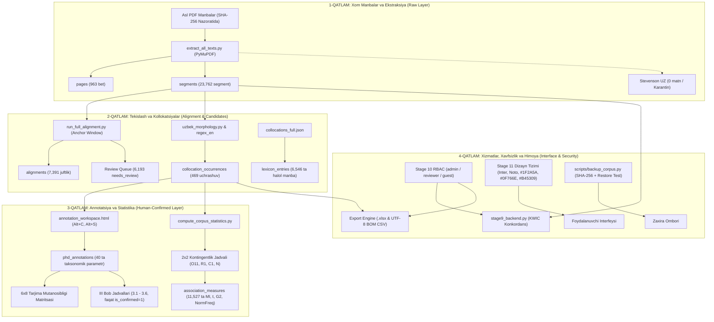

# TILCOR v2.0 — Tizim Arxitekturasi va Bosqichlar Zanjiri (ARCHITECTURE)

Ushbu hujjat platformaning 12 bosqichli ilmiy qayta tiklash konveyeri va uning qat'iy ajratilgan qatlamlarini tavsiflaydi.

---

## Asosiy Qoidalar (Architectural Invariants)
1. **Rule R1 (Zero Data Fabrication):** Hech bir raqam yoki matn qatlami taxmin qilib qo‘shilmaydi.
2. **Rule R3 (Three Strictly Separated Layers):**
   - *Raw Data:* Faqat manbadan olingan xom jumlalar va tokenlar.
   - *Draft / AI Suggestions:* Tavsiya holatidagi qoralamalar, statistikaga ta'sir qilmaydi.
   - *Confirmed Research Data:* Faqat inson-tadqiqotchi tomonidan tasdiqlangan annotatsiyalar.
3. **Rule R8 (Canonical Unicode):** O‘zbekcha `U+02BB` va `U+02BC` belgilari standartlashtirilgan.
4. **Direction Invariant:** Original doimo chapda, Tarjima doimo o‘ngda.
